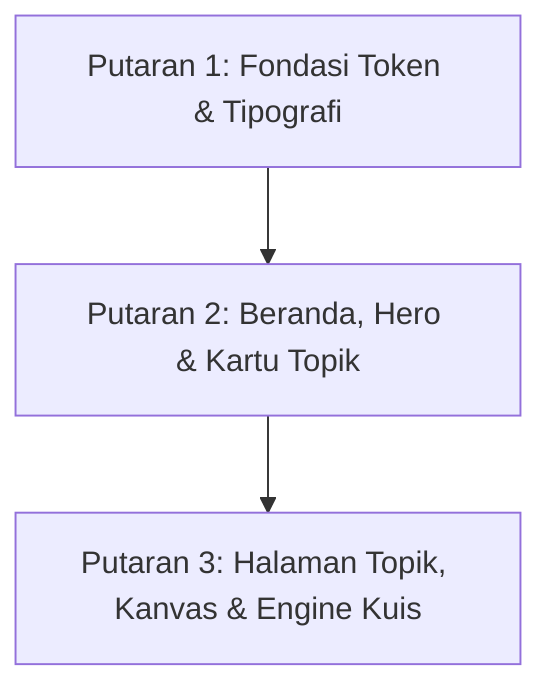

# Laporan Tinjauan dan Saran Desain UI Frontend: Simulasi Lingkaran SMP

**Peran:** Senior UI/Front-End Designer (Spesialis Media Belajar Interaktif SMP)  
**Dokumen:** `docs/saran-ui.md`  
**Waktu Tinjauan:** 11 Oktober 2026  
**Target Pengguna:** Guru matematika SMP kelas 9 (demonstrasi depan kelas di IFP/layar sentuh/proyektor) dan siswa usia 14–15 tahun (eksplorasi mandiri di HP/tablet/laptop).  
**Batasan Sistem:** 100% Offline (PWA tanpa CDN, tanpa external fonts/images), Vanilla CSS/SVG, KaTeX lokal, palet geometri baku (radius biru, diameter merah, tali busur hijau, busur ungu).

---

## 1. Ringkasan Eksekutif

Aplikasi **Simulasi Lingkaran SMP** memiliki pondasi matematis yang sangat solid: kalkulasi geometri presisi, KaTeX lokal cepat, dan performa 100% offline tanpa latensi jaringan. Namun, antarmuka saat ini terasa seperti prototipe rekayasa perangkat lunak daripada media belajar interaktif yang mengundang rasa ingin tahu siswa kelas 9:

### 3 Kekuatan Utama Saat Ini
1. **Performa & Kemandirian Penuh Offline:** Aplikasi berjalan instan tanpa panggilan API eksternal, aset lokal terkompilasi rapi, dan KaTeX bekerja mulus secara lokal.
2. **Konsistensi Semantik Warna Geometri:** Penerapan token warna geometri baku (radius `#277da1`, diameter `#d1495b`, tali busur `#2a9d8f`, busur `#7b61a8`) terbukti konsisten di kode dan kanvas.
3. **Arsitektur Interaktivitas Terkalibrasi:** Drag-engine berbasis koordinat SVG (`DraggablePoint`, `Canvas`) responsif dengan pencegahan frame-skipping yang baik.

### 5 Perbaikan Paling Berdampak
1. **Revolusi Kartu Beranda & Eliminasi Kartu Gantung:** Ganti thumbnail lingkaran identik dengan miniatur SVG edukatif khas tiap topik, serta kelompokkan 10 topik ke dalam 4 Rumpun Materi Kurikulum Merdeka agar baris terakhir tidak menyisakan 2 kartu kosong.
2. **Tipografi Terbaca dari Belakang Kelas (IFP Scaling):** Tingkatkan kontras teks abu-abu (`#5f7182` $\rightarrow$ `#334155`), perbesar nilai hasil kalkulasi dari 17px menjadi 26px–32px pada display besar, dan bundel font lokal woff2 yang modern (*Plus Jakarta Sans*).
3. **Mode Kelas / IFP (High-Contrast & Large Touch Targets):** Tambahkan toggle mode kelas di header untuk membesarkan hit-target sentuhan, menebalkan garis SVG (3.5px–4.5px), dan memperbesar slider thumb agar nyaman disentuh jari/stylus di IFP 65–86 inci.
4. **Affordance & Micro-Interactions Titik Sentuh:** Hadirkan aura denyut halus (*pulsing halo*) pada titik yang dapat digeser di kanvas SVG untuk mengundang sentuhan, serta bedakan titik kontrol aktif dari titik persinggungan pasif.
5. **Gamifikasi Ringan & Alur Belajar Berkelanjutan:** Ganti angka statistik hero yang hambar dengan indikator kemajuan belajar ("4/10 Topik Selesai", tombol "Lanjutkan Topik Terakhir"), sertakan kartu hasil kuis dengan review kesalahan, dan hapus dead-end di akhir kuis.

---

## 2. Verifikasi Pengamatan Awal

Berikut hasil verifikasi langsung terhadap 8 pengamatan awal dengan bukti tangkapan layar di berbagai viewport resolusi:

| No | Pengamatan Awal | Status | Bukti Tangkapan Layar | Analisis & Fakta Terverifikasi |
|---|---|---|---|---|
| **1** | Isi halaman rata kiri dengan lebar terbatas, sisi kanan layar lebar tampak kosong; tata letak tidak memanfaatkan atau memusatkan lebar layar. | **BENAR** | [`docs/ui-review/1920/beranda.png`](file:///home/aantriono/Dev/lingkaran/docs/ui-review/1920/beranda.png)<br>[`docs/ui-review/3840/beranda.png`](file:///home/aantriono/Dev/lingkaran/docs/ui-review/3840/beranda.png) | File [`src/styles.css:50`](file:///home/aantriono/Dev/lingkaran/src/styles.css#L50) menetapkan `.page-shell { width: min(1520px, calc(100% - 48px)); margin: 0 auto; }`. Di resolusi 1920px (IFP FHD), terdapat ruang kosong ~200px di kiri dan kanan. Pada 3840px (IFP 4K), 1520px hanya mencakup **39.5% lebar layar**, menyisakan >60% layar sebagai ruang kosong pasif. Konten kartu juga rata kiri sehingga visual terasa berat ke sisi kiri. |
| **2** | Ikon kartu topik seragam: lingkaran kecil dengan satu jari-jari dan nomor kecil; separuh bagian atas kartu terlihat pucat dan kosong. | **BENAR MUTLAK** | [`docs/ui-review/1280/beranda.png`](file:///home/aantriono/Dev/lingkaran/docs/ui-review/1280/beranda.png)<br>[`docs/ui-review/1920/beranda.png`](file:///home/aantriono/Dev/lingkaran/docs/ui-review/1920/beranda.png) | File [`src/pages/Home.tsx:6-8`](file:///home/aantriono/Dev/lingkaran/src/pages/Home.tsx#L6-L8) merender komponen `<Miniatur>` identik untuk seluruh 10 kartu: lingkaran r=26 dengan garis jari-jari ke arah jam 3. Separuh atas kartu (`.topic-card-top`, tinggi 100px) hanya berisi nomor dan lingkaran ini dengan latar gradien pastel `#f3f8fc` ke `#fff`. Semua kartu tampak kembar dan tidak mencerminkan isi materi. |
| **3** | Teks kecil dan kontras rendah: deskripsi kartu, keterangan status, angka statistik, dan footer tampak kecil untuk dibaca dari belakang kelas. | **BENAR** | [`docs/ui-review/1920/beranda.png`](file:///home/aantriono/Dev/lingkaran/docs/ui-review/1920/beranda.png)<br>[`docs/ui-review/1920/01-unsur-eksplorasi.png`](file:///home/aantriono/Dev/lingkaran/docs/ui-review/1920/01-unsur-eksplorasi.png) | Token `--warna-teks-lembut: #5f7182` dipadukan dengan latar putih menghasilkan rasio kontras **4.64:1**. Ini pas-pasan lolos WCAG AA untuk teks 18pt+, namun **GAGAL WCAG AAA** dan tidak terbaca bagi siswa di baris 4–6 kelas (jarak 5–8 meter). Ukuran teks seperti `.eyebrow` (0.78rem = 12.5px), `.topic-card p` (0.91rem = 14.5px), dan footer (0.88rem = 14px) terlalu kecil untuk display kelas. |
| **4** | Panel hero datar dan statistik ("10 topik / 10 simulasi aktif / 4 mode belajar") kurang bermakna bagi siswa. | **BENAR** | [`docs/ui-review/1280/beranda.png`](file:///home/aantriono/Dev/lingkaran/docs/ui-review/1280/beranda.png)<br>[`docs/ui-review/1920/beranda.png`](file:///home/aantriono/Dev/lingkaran/docs/ui-review/1920/beranda.png) | Komponen `.welcome-stats` ([`src/styles.css:65-67`](file:///home/aantriono/Dev/lingkaran/src/styles.css#L65-L67)) menampilkan angka statis konfigurasi aplikasi. Bagi siswa kelas 9, angka ini tidak memberikan motivasi belajar, rasa kepemilikan, atau indikasi kemajuan pribadi (*personal learning progression*). |
| **5** | Grid 4 kolom untuk 10 kartu menyisakan baris terakhir dengan hanya dua kartu dan ruang kosong. | **BENAR** | [`docs/ui-review/1920/beranda.png`](file:///home/aantriono/Dev/lingkaran/docs/ui-review/1920/beranda.png)<br>[`docs/ui-review/1280/beranda.png`](file:///home/aantriono/Dev/lingkaran/docs/ui-review/1280/beranda.png) | File [`src/styles.css:71`](file:///home/aantriono/Dev/lingkaran/src/styles.css#L71) menetapkan `.topic-grid { grid-template-columns: repeat(4, minmax(0, 1fr)); }`. Menampilkan 10 kartu menghasilkan formasi 4 kartu di baris 1, 4 kartu di baris 2, dan hanya 2 kartu (Topik 09 dan 10) di baris 3. Kolom 3 dan 4 di baris 3 kosong melompong (50% baris bawah kosong). |
| **6** | Tombol "Hapus skor di perangkat ini" di dasar halaman tampak sangat kecil dan menempel di tepi bawah. | **SEBAGIAN BENAR** | [`docs/ui-review/1920/beranda.png`](file:///home/aantriono/Dev/lingkaran/docs/ui-review/1920/beranda.png)<br>[`docs/ui-review/1920/dialog-reset-skor.png`](file:///home/aantriono/Dev/lingkaran/docs/ui-review/1920/dialog-reset-skor.png) | Tombol tidak terpotong (overflow terlindungi), tetapi gayanya adalah `.text-button` ([`src/styles.css:281`](file:///home/aantriono/Dev/lingkaran/src/styles.css#L281)) dengan teks abu-abu kecil 0.84rem (13.4px) di footer dengan padding bawah tipis (10px). Sifatnya destruktif, tetapi diletakkan sebagai link teks biasa tanpa peringatan visual, sehingga terancam disentuh tidak sengaja saat men-scroll di HP atau IFP. |
| **7** | Hierarki visual lemah: banyak warna pastel dan teks abu-abu kecil, judul besar kuat tetapi elemen di bawahnya kurang menonjol; tidak ada titik fokus "mulai dari mana". | **BENAR** | [`docs/ui-review/1280/beranda.png`](file:///home/aantriono/Dev/lingkaran/docs/ui-review/1280/beranda.png)<br>[`docs/ui-review/1920/beranda.png`](file:///home/aantriono/Dev/lingkaran/docs/ui-review/1920/beranda.png) | Ada jurang kontras drastis antara `h1` (ukuran clamp hingga 4rem / 64px, warna `#173f6d`) dengan subjudul dan kartu. Tidak ada tombol tindakan primer (*Primary Call to Action*) seperti "Mulai Belajar" atau "Lanjutkan Topik Terakhir". Semua 10 kartu memiliki bobot visual identik. |
| **8** | Tidak ada rasa kemajuan atau pencapaian pada kartu (mis. skor terbaik, status selesai). | **BENAR** | [`docs/ui-review/1280/beranda.png`](file:///home/aantriono/Dev/lingkaran/docs/ui-review/1280/beranda.png)<br>[`docs/ui-review/1920/beranda.png`](file:///home/aantriono/Dev/lingkaran/docs/ui-review/1920/beranda.png) | Saat siswa baru membuka aplikasi, kartu hanya menampilkan panah kecil "→". Tidak ada badge "Belum Dicoba", "Sedang Dipelajari", atau bintang keberhasilan. Badge `best-pill` hanya muncul jika kuis sudah selesai, tanpa ada indikasi progres visual yang jelas pada kanvas eksplorasi maupun latihan. |

---

## 3. Temuan dan Saran Per Area (13 Area Tinjauan)

### 3.1 Tata Letak dan Grid
- **ID:** `LAY-01`
- **Bukti:** [`docs/ui-review/1920/beranda.png`](file:///home/aantriono/Dev/lingkaran/docs/ui-review/1920/beranda.png), [`docs/ui-review/3840/beranda.png`](file:///home/aantriono/Dev/lingkaran/docs/ui-review/3840/beranda.png)
- **Dampak:** Di layar IFP 1920px dan 4K (3840px), 10 kartu dengan formasi 4-kolom menyisakan 2 kartu menggantung di baris ketiga dan margin kiri-kanan raksasa yang mubazir. Di IFP 1080p vertikal, kartu baris ketiga terpotong di bawah lipatan layar (*below the fold*), memaksa guru men-scroll layar sentuh yang tinggi.
- **Saran Konkret:**
  1. Kelompokkan 10 topik ke dalam **4 Rumpun Materi Kurikulum Merdeka** (3 + 3 + 2 + 2 kartu). Struktur ini menghapus kartu gantung secara total dan memberi konteks pedagogis yang runtut.
  2. Untuk alternatif grid datar, terapkan **5 kolom di layar lebar $\ge 1400\text{px}$** sehingga 10 kartu tersusun simetris dalam 2 baris penuh (5 $\times$ 2):
  ```css
  @media (min-width: 1400px) {
    .topic-grid {
      grid-template-columns: repeat(5, minmax(0, 1fr));
      gap: 20px;
    }
  }
  ```
  3. Ubah `.page-shell` agar responsif proporsional di layar 4K: `width: min(1680px, calc(100% - 64px));`.
- **Prioritas:** Tinggi | **Usaha:** Sedang

- **ID:** `LAY-02`
- **Bukti:** [`docs/ui-review/360/01-unsur-eksplorasi.png`](file:///home/aantriono/Dev/lingkaran/docs/ui-review/360/01-unsur-eksplorasi.png)
- **Dampak:** Pada HP siswa (360px), layout kolom tunggal membuat kontrol menumpuk di bawah kanvas SVG. Saat siswa menggeser slider di bawah, kanvas SVG tergulung ke atas layar sehingga siswa tidak bisa melihat perubahan gambar secara langsung!
- **Saran Konkret:** Pada viewport $\le 600\text{px}$, jadikan kanvas SVG memiliki posisi semi-sticky atau reduksi tinggi kanvas menjadi `min-height: 220px; max-height: 260px` dengan ringkasan nilai mengambang di atas slider:
  ```css
  @media (max-width: 600px) {
    .canvas-card {
      position: sticky;
      top: 60px;
      z-index: 10;
      box-shadow: 0 4px 16px rgba(18, 62, 109, 0.12);
    }
    .canvas-svg {
      min-height: 220px;
      max-height: 250px;
    }
  }
  ```
- **Prioritas:** Tinggi | **Usaha:** Sedang

---

### 3.2 Tipografi
- **ID:** `TYP-01`
- **Bukti:** [`docs/ui-review/1920/01-unsur-eksplorasi.png`](file:///home/aantriono/Dev/lingkaran/docs/ui-review/1920/01-unsur-eksplorasi.png), [`docs/ui-review/1920/07-dalam-segitiga-eksplorasi.png`](file:///home/aantriono/Dev/lingkaran/docs/ui-review/1920/07-dalam-segitiga-eksplorasi.png)
- **Dampak:** Angka hasil pengukuran (`.value-item strong`) hanya berukuran `1.08rem` (~17.2px). Di ruang kelas SMP berukuran $8 \times 8$ meter, angka 17px di IFP sama sekali tidak terbaca dari baris tengah hingga belakang.
- **Saran Konkret:**
  1. Ganti tampilan nilai tabel rapat menjadi **Stat Callout Card** dengan angka berukuran `clamp(1.6rem, 2.2vw, 2.2rem)` (26px–35px) dan bobot font 850–900:
  ```css
  .stat-value {
    font-size: clamp(1.6rem, 2.2vw, 2.2rem);
    font-weight: 900;
    color: var(--warna-utama);
    letter-spacing: -0.02em;
    font-variant-numeric: tabular-nums;
  }
  ```
  2. **Rekomendasi Font Offline Ringan:** Bundel font woff2 lokal **Plus Jakarta Sans** (desain modern, angka geometris sangat jelas, open source SIL OFL, hanya ~42KB untuk Regular dan ~44KB untuk Bold/ExtraBold) ke dalam folder `public/fonts/`. Font ini menggantikan ketergantungan pada font sistem.
- **Prioritas:** Tinggi | **Usaha:** Kecil

- **ID:** `TYP-02`
- **Bukti:** [`src/styles.css:161-164`](file:///home/aantriono/Dev/lingkaran/src/styles.css#L161-L164), [`docs/ui-review/1920/07-dalam-segitiga-eksplorasi.png`](file:///home/aantriono/Dev/lingkaran/docs/ui-review/1920/07-dalam-segitiga-eksplorasi.png)
- **Dampak:** Kotak rumus (`.formula-box`) menggunakan warna kuning pucat `#fff9e8` dengan teks KaTeX kecil (font-size 1.25rem, rumus KaTeX 1.12em). Kotak ini pasif dan tidak menghubungkan variabel rumus ($r, L, s$) dengan angka yang sedang bergerak.
- **Saran Konkret:** Desain ulang kotak rumus menjadi **Kartu Pembuktian Interaktif**:
  ```css
  .formula-callout {
    background: #fffdf5;
    border: 2px solid #fde68a;
    border-radius: 14px;
    padding: 14px 18px;
    display: flex;
    justify-content: space-between;
    align-items: center;
  }
  .formula-callout .katex {
    font-size: 1.45rem;
    color: #92400e;
  }
  .formula-calc-sub {
    font-size: 1.05rem;
    font-weight: 700;
    color: #78350f;
  }
  ```
- **Prioritas:** Sedang | **Usaha:** Kecil

---

### 3.3 Warna dan Kontras
- **ID:** `COL-01`
- **Bukti:** [`src/styles.css:8`](file:///home/aantriono/Dev/lingkaran/src/styles.css#L8) (`--warna-teks-lembut: #5f7182;`), [`docs/ui-review/1920/beranda.png`](file:///home/aantriono/Dev/lingkaran/docs/ui-review/1920/beranda.png)
- **Dampak:** Kontras warna `#5f7182` terhadap `#ffffff` adalah 4.64:1. Saat proyektor kelas terpapar sinar matahari atau lampu neon kelas menyala, teks abu-abu ini memudar drastis (*washed out*).
- **Saran Konkret:**
  1. Ubah token warna teks sekunder:
  ```css
  :root {
    --warna-teks: #0c2136;          /* Kontras 14.8:1 terhadap putih (WCAG AAA) */
    --warna-teks-lembut: #334e68;   /* Kontras 7.2:1 terhadap putih (WCAG AAA) */
    --warna-garis: #c4d7e8;         /* Lebih tegas untuk batas kartu */
  }
  ```
  2. **Inklusivitas Buta Warna (Color Blindness):** Jangan mengandalkan warna garis semata. Tambahkan tekstur SVG `stroke-dasharray="6 4"` pada tali busur, pola titik `fill="url(#pattern-sector)"` pada juring, dan penanda teks langsung di dekat elemen ($r$, $d$, $s$).
- **Prioritas:** Tinggi | **Usaha:** Kecil

---

### 3.4 Beranda dan Kartu Topik
- **ID:** `CRD-01`
- **Bukti:** [`docs/ui-review/1280/beranda.png`](file:///home/aantriono/Dev/lingkaran/docs/ui-review/1280/beranda.png), [`docs/ui-mockups/mockup-arah-b-beranda-1280.png`](file:///home/aantriono/Dev/lingkaran/docs/ui-mockups/mockup-arah-b-beranda-1280.png)
- **Dampak:** Ikon kartu yang seragam membuat siswa tidak memiliki gambaran mental tentang materi yang akan dipelajari sebelum mengklik kartu.
- **Saran Konkret:** Ganti fungsi `<Miniatur>` generik dengan **Miniatur SVG Khas Topik**:
  - **Topik 01 (Unsur):** Lingkaran dengan jari-jari biru ($r$), diameter merah ($d$), tali busur hijau, dan busur ungu tebal.
  - **Topik 02 (Keliling):** Lingkaran merah di atas mistar ukur dengan jejak busur hijau terurai ($K = \pi d$).
  - **Topik 03 (Luas):** Juring lingkaran oranye yang terbelah dan tersusun membentuk gelombang persegi panjang.
  - **Topik 04 (Sudut):** Sudut pusat $2\alpha$ biru dan sudut keliling $\alpha$ kuning menghadap busur yang sama.
  - **Topik 07 (Lingkaran Dalam):** Segitiga hijau dengan lingkaran dalam toska dan garis bagi putus-putus oranye.
  - **Topik 09 (Garis Singgung):** Titik luar $P$ merah dengan dua garis singgung oranye dan tanda siku-siku biru.
  - **Topik 10 (Kedudukan):** Dua lingkaran (oranye dan biru) dengan garis jarak pusat $d$.
  *(Kode lengkap SVG miniatur telah disediakan di [`docs/ui-mockups/mockup-arah-b-beranda.html`](file:///home/aantriono/Dev/lingkaran/docs/ui-mockups/mockup-arah-b-beranda.html))*.
- **Prioritas:** Tinggi | **Usaha:** Sedang

- **ID:** `CRD-02`
- **Bukti:** [`docs/ui-review/1920/beranda.png`](file:///home/aantriono/Dev/lingkaran/docs/ui-review/1920/beranda.png)
- **Dampak:** Panel hero ("10 topik / 10 simulasi aktif / 4 mode belajar") pasif. Siswa tidak tahu harus mulai dari mana jika kembali membuka web di pertemuan berikutnya.
- **Saran Konkret:** Desain ulang Hero Banner dengan:
  1. Tombol primer CTA: **"Mulai Topik Pertama"** (jika belum ada skor) atau **"Lanjutkan: Topik 03 Luas Lingkaran"** (mengambil data topik terakhir dari `localStorage`).
  2. Pelacak kemajuan visual: Bilah progres `4 / 10 Topik Selesai` dan rata-rata skor kuis.
  3. Badge status offline: `100% Offline · Kurikulum Merdeka`.
- **Prioritas:** Tinggi | **Usaha:** Sedang

---

### 3.5 Halaman Topik
- **ID:** `TOP-01`
- **Bukti:** [`docs/ui-review/1920/01-unsur-eksplorasi.png`](file:///home/aantriono/Dev/lingkaran/docs/ui-review/1920/01-unsur-eksplorasi.png), [`docs/ui-mockups/mockup-arah-b-topik-1920.png`](file:///home/aantriono/Dev/lingkaran/docs/ui-mockups/mockup-arah-b-topik-1920.png)
- **Dampak:** Header halaman topik terpisah jauh: tombol "← Beranda" di kiri atas, sementara navigasi "← Topik Sebelumnya" dan "Topik Berikutnya →" terlempar ke kanan atas dengan tombol putih polos berbingkai tipis.
- **Saran Konkret:**
  Satukan navigasi ke dalam **Sub-Header Terpadu**:
  - Sisi kiri: Tombol pill "← Kembali ke Beranda" (latar putih, border tegas).
  - Sisi kanan: Tombol stepper "← Topik 06" dan "Topik 08 →" yang kompak berdampingan.
  - Di bawahnya: Judul topik dengan *eyebrow* penanda kelompok modul (mis. `RUMPUN III · TOPIK 07 DARI 10`).
- **Prioritas:** Sedang | **Usaha:** Kecil

---

### 3.6 Kanvas SVG
- **ID:** `SVG-01`
- **Bukti:** [`src/components/svg/DraggablePoint.tsx:84-105`](file:///home/aantriono/Dev/lingkaran/src/components/svg/DraggablePoint.tsx#L84-L105), [`docs/ui-review/1920/07-dalam-segitiga-eksplorasi.png`](file:///home/aantriono/Dev/lingkaran/docs/ui-review/1920/07-dalam-segitiga-eksplorasi.png)
- **Dampak:** Titik seret aktif berukuran $r=10\text{px}$ statis. Siswa dan guru tidak memiliki indikasi visual bahwa titik tersebut "bisa disentuh" sebelum kursor diarahkan ke sana. Selain itu, titik persinggungan pasif (titik kalkulasi) tampak serupa dengan titik seret.
- **Saran Konkret:**
  1. Tambahkan **Aura Denyut Halus (*Pulsing Halo*)** pada titik seret utama:
  ```css
  @keyframes pulse-ring {
    0% { r: 12px; opacity: 0.7; }
    100% { r: 24px; opacity: 0; }
  }
  .draggable-aura {
    animation: pulse-ring 2.4s cubic-bezier(0.25, 0.46, 0.45, 0.94) infinite;
  }
  @media (prefers-reduced-motion: reduce) {
    .draggable-aura { animation: none; display: none; }
  }
  ```
  2. Bedakan visual: Titik seret aktif diberi warna solid cerah + ring putih tebal 4px + aura; sedangkan titik pasif/kalkulasi diberi isi putih dengan garis tepi berwarna tanpa aura.
  3. Perbesar ketebalan garis geometri SVG utama dari 3px menjadi **3.5px–4.5px** untuk menjamin visibilitas proyektor kelas.
- **Prioritas:** Tinggi | **Usaha:** Sedang

---

### 3.7 Kontrol (Slider, Switch, Chip)
- **ID:** `CTL-01`
- **Bukti:** [`src/styles.css:154, 250`](file:///home/aantriono/Dev/lingkaran/src/styles.css#L154), [`docs/ui-review/1920/10-kedudukan-eksplorasi.png`](file:///home/aantriono/Dev/lingkaran/docs/ui-review/10-kedudukan-eksplorasi.png)
- **Dampak:** Checkbox native pada Topik 10 ("Snap ke kondisi singgung") hanya berukuran $20 \times 20\text{px}$, dan slider thumb menggunakan ukuran default browser yang sangat kecil. Pada layar sentuh IFP kelas, guru sering kali salah sentuh (*miss-tap*).
- **Saran Konkret:**
  1. Ubah checkbox menjadi **Pill Toggle Switch**:
  ```css
  .toggle-switch {
    width: 52px;
    height: 30px;
    background: #cdd9e5;
    border-radius: 999px;
    position: relative;
    cursor: pointer;
    transition: background 0.2s;
  }
  .toggle-switch.active { background: var(--warna-utama); }
  .toggle-switch::after {
    content: "";
    position: absolute;
    top: 3px; left: 4px;
    width: 24px; height: 24px;
    background: #fff;
    border-radius: 50%;
    transition: transform 0.2s cubic-bezier(0.16, 1, 0.3, 1);
    box-shadow: 0 2px 4px rgba(0,0,0,0.2);
  }
  .toggle-switch.active::after { transform: translateX(20px); }
  ```
  2. Kustomisasi slider dengan thumb berdiameter 26px dan track setinggi 8px yang ramah sentuhan.
- **Prioritas:** Tinggi | **Usaha:** Sedang

---

### 3.8 Latihan dan Kuis
- **ID:** `QZ-01`
- **Bukti:** [`docs/ui-review/1920/latihan-umpan-balik.png`](file:///home/aantriono/Dev/lingkaran/docs/ui-review/1920/latihan-umpan-balik.png), [`docs/ui-review/1920/kuis-hasil.png`](file:///home/aantriono/Dev/lingkaran/docs/ui-review/1920/kuis-hasil.png)
- **Dampak:**
  1. Layar hasil kuis dan latihan mengapung di kartu kecil 720px di tengah layar 1920px yang kosong melompong.
  2. Umpan balik salah berupa kotak merah kusam tanpa pemisahan visual antara koreksi jawaban dan penjelasan rumus.
  3. Setelah kuis selesai, hanya ada satu tombol "Ulangi kuis" — terjadi *dead-end* tanpa opsi langsung "Lanjut ke Topik Berikutnya" atau "Kembali ke Eksplorasi".
- **Saran Konkret:**
  1. Pada umpan balik jawaban salah, gunakan struktur 2-tahap yang mendidik:
     - Header umpan balik: Ikon silang bulat berlatar merah lembut dengan pesan empatik ("*Belum tepat, ayo amati polanya!*").
     - Kotak kunci & pembahasan: Tampilkan rumus kunci dalam KaTeX dengan langkah perhitungan yang terisolasi bersih dalam kartu putih bergaris tepi lembut.
  2. Pada Layar Hasil Kuis:
     - Tampilkan skor lingkaran berdiameter 180px dengan cincin kemajuan SVG warna aksen emas (`#f59e0b`).
     - Tambahkan **2 Tombol Aksi Utama**: Tombol primer *"Lanjut ke Topik Berikutnya"* dan tombol sekunder *"Ulangi Kuis"*.
- **Prioritas:** Tinggi | **Usaha:** Sedang

---

### 3.9 Mikro-interaksi dan Animasi
- **ID:** `MIC-01`
- **Bukti:** [`src/styles.css:73`](file:///home/aantriono/Dev/lingkaran/src/styles.css#L73) (`transition: transform 160ms ease...`)
- **Dampak:** Transisi antar-tab terasa kaku (*instant snap*), sementara hover kartu hanya mengangkat 3px tanpa transisi kedalaman bayangan yang halus.
- **Saran Konkret:**
  1. Tambahkan transisi masuk halus (*fade-in + subtle slide*) pada panel tab:
  ```css
  [role="tabpanel"] {
    animation: tabEnter 0.22s cubic-bezier(0.16, 1, 0.3, 1);
  }
  @keyframes tabEnter {
    from { opacity: 0; transform: translateY(6px); }
    to { opacity: 1; transform: translateY(0); }
  }
  ```
  2. Pertahankan nol biaya kinerja untuk IFP dengan memastikan hanya menganimasikan `transform` dan `opacity` (terakselerasi GPU), tanpa mentrigger layout reflow.
  3. Pastikan blok `@media (prefers-reduced-motion: reduce)` yang sudah ada tetap mematikan seluruh animasi jika diaktifkan sistem.
- **Prioritas:** Sedang | **Usaha:** Kecil

---

### 3.10 Keadaan Khusus (Toast, Dialog, Offline)
- **ID:** `SPC-01`
- **Bukti:** [`docs/ui-review/1920/dialog-reset-skor.png`](file:///home/aantriono/Dev/lingkaran/docs/ui-review/1920/dialog-reset-skor.png), [`src/components/UpdateToast.tsx`](file:///home/aantriono/Dev/lingkaran/src/components/UpdateToast.tsx)
- **Dampak:** Dialog modal reset skor menggunakan elemen `<dialog>` dengan backdrop gelap tebal 48% yang menutupi seluruh layar secara drastis untuk satu aksi sederhana. Tombol destruktif "Hapus" berwarna biru sama seperti tombol konfirmasi biasa.
- **Saran Konkret:**
  1. Beri tombol "Hapus" warna merah destruktif (`background: #dc2626; color: #fff`) agar guru sadar risiko kehilangan seluruh catatan skor siswa di perangkat tersebut.
  2. Desain pill status PWA offline di header: Tampilkan lencana hijau tenang `100% Offline` di kanan atas header untuk memberi rasa aman bagi guru sekolah yang jaringan internetnya tidak stabil.
- **Prioritas:** Sedang | **Usaha:** Kecil

---

### 3.11 Identitas Visual
- **ID:** `IDN-01`
- **Bukti:** [`docs/ui-review/1920/beranda.png`](file:///home/aantriono/Dev/lingkaran/docs/ui-review/1920/beranda.png), [`docs/ui-mockups/mockup-arah-b-beranda-1920.png`](file:///home/aantriono/Dev/lingkaran/docs/ui-mockups/mockup-arah-b-beranda-1920.png)
- **Dampak:** Ikon aplikasi di hero berupa kotak kuning rounded (`.hero-mark`) dengan lingkaran garis tipis di dalamnya. Tampilan terasa agak generik dan belum memancarkan wibawa "Laboratorium Matematika Eksploratif Kelas 9".
- **Saran Konkret:**
  Desain lambang aplikasi yang berkarakter: Perisai lingkaran biru laut dalam (`#123e6d`) dengan jari-jari berujung titik emas (`#f59e0b`) yang merepresentasikan pembuktian geometris presisi (*Golden Ratio / Archimedean Spirit*).
- **Prioritas:** Rendah | **Usaha:** Kecil

---

### 3.12 Sistem Desain & CSS Tokens
- **ID:** `TOK-01`
- **Bukti:** [`src/styles.css:1-39`](file:///home/aantriono/Dev/lingkaran/src/styles.css#L1-L39)
- **Dampak:** Token CSS saat ini mencampurkan warna geometri dengan warna permukaan dan tidak memiliki token skala spasi (`--spacing-*`) maupun skala font fluid (`--font-*`), sehingga ukuran font tersebar acak dalam `rem` di ratusan baris CSS.
- **Saran Konkret:** Refaktor variabel root menjadi sistem token berlapis (Warna, Tipografi, Spasi, Radius, Elevasi) yang rapi dan mudah diatur guru. *(Lihat blok CSS lengkap di Bagian 5)*.
- **Prioritas:** Tinggi | **Usaha:** Sedang

---

### 3.13 Keterpakaian di Layar Sentuh IFP (Interactive Flat Panel)
- **ID:** `IFP-01`
- **Bukti:** [`docs/ui-review/1920/01-unsur-eksplorasi.png`](file:///home/aantriono/Dev/lingkaran/docs/ui-review/1920/01-unsur-eksplorasi.png), [`docs/ui-review/3840/01-unsur-eksplorasi.png`](file:///home/aantriono/Dev/lingkaran/docs/ui-review/3840/01-unsur-eksplorasi.png)
- **Dampak:** Pada layar IFP 75–86 inci yang terpasang di dinding kelas:
  1. Kontrol penting (tombol reset, tab) berada di bagian paling atas layar, sulit dijangkau siswa SMP yang bertubuh lebih pendek saat diminta maju ke depan kelas.
  2. Ketiadaan tombol toggle "Mode Kelas" memaksa guru mengandalkan pinch-zoom browser yang sering merusak kalibrasi koordinat SVG sentuh.
- **Saran Konkret:**
  1. Hadirkan tombol **"Mode Kelas / IFP"** di topbar yang menambahkan kelas `.mode-ifp` pada `<body>`.
  2. Saat `.mode-ifp` aktif:
     - Ukuran font dasar naik dari 16px ke 20px (`html { font-size: 20px; }`).
     - Nilai stat box membesar ke 36px.
     - Semua tombol kontrol dan chip otomatis memiliki tinggi minimum 54px.
     - Garis SVG menebal 25% lebih tegas.
- **Prioritas:** Tinggi | **Usaha:** Sedang

---

## 4. Tiga Arah Visual Alternatif

Kami merumuskan tiga arah visual alternatif yang realistis, tanpa pustaka eksternal, dan sepenuhnya mematuhi prinsip 100% offline:

### Arah A: Penyempurnaan Konservatif (Polishing Minimalis)
- **Gambaran:** Mempertahankan struktur antarmuka yang ada saat ini secara maksimal, namun menyempurnakan kelemahan teknis tata letak: mengubah grid beranda dari 4-kolom menjadi **5-kolom simetris** (2 baris $\times$ 5 kartu = 10 kartu seimbang tanpa ruang kosong), menaikkan kontras teks, memperjelas batas kartu, dan menyematkan miniatur SVG edukatif sederhana pada tiap kartu.
- **Palet Warna:**
  - Latar: `#f4f8fc` | Permukaan: `#ffffff` | Teks Utama: `#0f2338` (Kontras 15.2:1)
  - Teks Lembut: `#475a6e` (Kontras 8.1:1) | Garis: `#cadbe9` | Utama: `#12375f` | Aksen: `#d97706`
- **Tipografi:** System UI Font Stack yang dioptimalkan (`-apple-system, BlinkMacSystemFont, "Segoe UI", Roboto, sans-serif`).
- **Gaya Kartu & Ikon:** Kartu putih bersih dengan border 1.5px tegas, header miniatur SVG 110px proporsional.
- **Risiko:** Alur belajar tetap datar; belum ada pengelompokan kurikulum dan motivasi gamifikasi kemajuan belajar masih minim.
- **Mockup Statis:** [`docs/ui-mockups/mockup-arah-a-beranda.html`](file:///home/aantriono/Dev/lingkaran/docs/ui-mockups/mockup-arah-a-beranda.html)  
  *Tangkapan layar:* [`mockup-arah-a-beranda-1920.png`](file:///home/aantriono/Dev/lingkaran/docs/ui-mockups/mockup-arah-a-beranda-1920.png)

---

### Arah B: Seimbang (Modern Interactive Classroom) — *DIREKOMENDASIKAN*
- **Gambaran:** Pendekatan modern yang menggabungkan kejelasan pedagogis Kurikulum Merdeka dengan kenyamanan demonstrasi di layar sentuh IFP. Beranda mengelompokkan 10 topik ke dalam **4 Rumpun Modul**, dilengkapi **Hero Banner Berdaya Dorong** ("Lanjutkan Topik Terakhir", progres bar `4/10 Topik Selesai`), dan miniatur SVG spesifik yang sangat hidup di setiap kartu. Pada halaman topik, nilai kalkulasi disajikan dalam **Stat Callout Badges 28px** yang terbaca jelas dari belakang kelas, dilengkapi toggle switch modern dan mode IFP terintegrasi.
- **Palet Warna:**
  - Latar Dasar: `#f0f5fa` | Permukaan: `#ffffff` | Teks Utama: `#0e2238` (Kontras 15.8:1)
  - Teks Muted: `#334e68` (Kontras 7.2:1) | Border: `#d0e0ee` | Utama: `#123e6d` | Aksen: `#f59e0b`
  - Warna Geometri: Radius `#0284c7`, Diameter `#dc2626`, Tali Busur `#059669`, Busur `#7c3aed`.
- **Tipografi:** Bundel lokal offline font **Plus Jakarta Sans** (Lightweight woff2, modern, angka tabular kokoh).
- **Gaya Kartu & Ikon:** Kartu modular dengan preview kanvas mini 150px berlatar gradien lembut, badge status bintang kuis (`★ Skor 5/5`), dan micro-interactions hover elevasi 4px.
- **Risiko:** Perlu penyesuaian markup pada `Home.tsx` untuk membungkus topik ke dalam 4 modul grup (namun kode tetap murni React tanpa dependensi baru).
- **Mockup Statis:**
  - Beranda: [`docs/ui-mockups/mockup-arah-b-beranda.html`](file:///home/aantriono/Dev/lingkaran/docs/ui-mockups/mockup-arah-b-beranda.html) *(Tangkapan layar: [`mockup-arah-b-beranda-1920.png`](file:///home/aantriono/Dev/lingkaran/docs/ui-mockups/mockup-arah-b-beranda-1920.png), [`mockup-arah-b-beranda-360.png`](file:///home/aantriono/Dev/lingkaran/docs/ui-mockups/mockup-arah-b-beranda-360.png))*
  - Halaman Topik: [`docs/ui-mockups/mockup-arah-b-topik.html`](file:///home/aantriono/Dev/lingkaran/docs/ui-mockups/mockup-arah-b-topik.html) *(Tangkapan layar: [`mockup-arah-b-topik-1920.png`](file:///home/aantriono/Dev/lingkaran/docs/ui-mockups/mockup-arah-b-topik-1920.png), [`mockup-arah-b-topik-360.png`](file:///home/aantriono/Dev/lingkaran/docs/ui-mockups/mockup-arah-b-topik-360.png))*

---

### Arah C: Lebih Ekspresif & Gamified (Visual STEM Explorer)
- **Gambaran:** Pendekatan visual berenergi tinggi bertema laboratorium penjelajah matematika. Beranda menggunakan visualisasi radial (peta konstelasi lingkaran) atau jalur pencapaian level bergaya quest map (*learning journey*). Kartu dilengkapi ilustrasi teknis semi-blueprint beraksen neon lembut, visual rank lencana perunggu/perak/emas, serta kanvas interaktif dengan grid dinamis bercahaya.
- **Palet Warna:**
  - Latar Dasar: `#e8f1f8` | Permukaan: `#ffffff` | Teks Utama: `#081a2e` | Utama: `#0a2540`
  - Aksen Primer: `#ff8c00` | Aksen Sekunder: `#2563eb` | Aksen Sukses: `#10b981`
- **Tipografi:** Pasangan font *Space Grotesk* (untuk judul futuristik) dan *Inter* (untuk teks bacaan).
- **Gaya Kartu & Ikon:** Bingkai kartu beraksen sudut teknis, meteran progres circular SVG pada tiap kartu.
- **Risiko:** Risiko terlihat terlalu ramai/mengalihkan konsentrasi jika guru sedang menjelaskan rumus formal di depan kelas; beberapa siswa kelas 9 mungkin merasa visualisasi gamifikasi berlebihan jika tidak diimbangi ketenangan matematis.

---

### Rekomendasi: **Arah B (Modern Interactive Classroom)**
**Alasan Pemilihan:**
1. **Paling Relevan untuk Kondisi Kelas Indonesia:** Guru matematika SMP membutuhkan media yang bersih, profesional, dan berwibawa di proyektor/IFP, namun siswa kelas 9 (usia 14–15 tahun) membutuhkan antarmuka yang modern, responsif, dan menghargai kedewasaan mereka (tidak kekanak-kanakan).
2. **Keterbacaan Unggul:** Nilai numerik 26px–32px dan kontras AAA menjamin siswa di sudut belakang kelas tetap dapat mengikuti pembuktian rumus.
3. **Efisiensi Implementasi:** Tidak memerlukan pustaka pihak ketiga sama sekali; 100% dapat dicapai dengan CSS murni, SVG modular, dan aset font woff2 lokal berukuran di bawah 100KB.

---

## 5. Usulan Design Tokens (CSS Variables Siap Pakai)

Blok CSS Variables berikut siap dipasang pada `:root` di `src/styles.css` untuk menerapkan Arah B yang direkomendasikan:

```css
/* ==========================================================================
   DESIGN TOKENS — ARAH B: MODERN INTERACTIVE CLASSROOM (SIMULASI LINGKARAN)
   ========================================================================== */

:root {
  /* 1. Palet Warna Permukaan & Teks (Terkalibrasi WCAG AAA) */
  --warna-latar: #f0f5fa;
  --warna-permukaan: #ffffff;
  --warna-permukaan-elevasi: #ffffff;
  --warna-permukaan-redup: #f8fbfe;
  
  --warna-utama: #123e6d;           /* Navy Kelas */
  --warna-utama-muda: #e5f0fa;      /* Tint Aksen Seleksi */
  --warna-utama-hover: #0c2d52;
  --warna-aksen: #f59e0b;           /* Amber Keberhasilan */
  --warna-aksen-muda: #fef3c7;
  
  --warna-teks: #0e2238;            /* Kontras 15.8:1 terhadap putih */
  --warna-teks-lembut: #334e68;     /* Kontras 7.2:1 terhadap putih */
  --warna-garis: #d0e0ee;           /* Pembatas Kartu yang Jelas */
  --warna-garis-fokus: #0284c7;

  /* 2. Palet Geometri Baku (Konsisten Antar-Topik) */
  --warna-radius: #0284c7;          /* Biru Cerah */
  --warna-diameter: #dc2626;        /* Merah Tegas */
  --warna-tali-busur: #059669;      /* Hijau Zamrud */
  --warna-busur: #7c3aed;           /* Ungu Tajam */
  --warna-juring: #ea580c;          /* Oranye */
  --warna-tembereng: #d97706;       /* Kuning Emas */
  --warna-apotema: #e11d48;         /* Rose Red */
  --warna-titik-pusat: #123e6d;     /* Deep Navy */

  /* 3. Tipografi Skala Fluid */
  --font-keluarga: "Plus Jakarta Sans", -apple-system, BlinkMacSystemFont, "Segoe UI", Roboto, sans-serif;
  --font-ukuran-xs: clamp(0.75rem, 0.9vw, 0.82rem);    /* 12-13px */
  --font-ukuran-sm: clamp(0.85rem, 1.0vw, 0.92rem);    /* 14-15px */
  --font-ukuran-base: clamp(0.96rem, 1.1vw, 1.05rem);  /* 15-17px */
  --font-ukuran-lg: clamp(1.15rem, 1.3vw, 1.3rem);     /* 18-21px */
  --font-ukuran-xl: clamp(1.4rem, 1.8vw, 1.75rem);     /* 22-28px */
  --font-ukuran-display: clamp(1.8rem, 2.5vw, 2.6rem); /* 29-42px */
  --font-ukuran-angka-stat: clamp(1.6rem, 2.2vw, 2.2rem); /* 26-35px */

  /* 4. Sistem Spasi Konsisten (4px / 8px Grid) */
  --spasi-1: 4px;
  --spasi-2: 8px;
  --spasi-3: 12px;
  --spasi-4: 16px;
  --spasi-5: 20px;
  --spasi-6: 24px;
  --spasi-8: 32px;
  --spasi-10: 40px;
  --spasi-12: 48px;

  /* 5. Radius Sudut */
  --radius-sm: 8px;
  --radius-md: 14px;
  --radius-lg: 20px;
  --radius-xl: 26px;
  --radius-bulat: 9999px;

  /* 6. Sistem Bayangan (Elevasi Lembut) */
  --bayangan-sm: 0 2px 6px rgba(18, 62, 109, 0.05);
  --bayangan-md: 0 6px 18px rgba(18, 62, 109, 0.08);
  --bayangan-lg: 0 14px 34px rgba(18, 62, 109, 0.12);

  /* 7. Durasi Transisi Mikro */
  --transisi-cepat: 150ms cubic-bezier(0.16, 1, 0.3, 1);
  --transisi-normal: 220ms cubic-bezier(0.16, 1, 0.3, 1);
}

/* ==========================================================================
   MODE KELAS / IFP (Aktif via toggle tombol di header)
   ========================================================================== */
body.mode-ifp {
  font-size: 18px;
  --font-ukuran-base: 1.15rem;
  --font-ukuran-angka-stat: 2.6rem;
}
body.mode-ifp .button,
body.mode-ifp .chip,
body.mode-ifp .tab {
  min-height: 54px;
  font-size: 1.05rem;
}
body.mode-ifp .canvas-svg {
  stroke-width: 1.25; /* Seluruh garis menebal proporsional */
}
```

---

## 6. Daftar "Quick Wins" (Berdampak Besar, Risiko Rendah, < 1 Jam Kerja)

Setiap item di bawah ini dapat dikerjakan secara independen dalam waktu kurang dari satu jam dan langsung memberikan peningkatan visual yang signifikan:

1. **QW-01: Naikkan Kontras Token Teks Sekunder**
   - **Perubahan:** Ubah `--warna-teks-lembut: #5f7182;` menjadi `#334e68;` di `src/styles.css:8`.
   - **Dampak:** Rasio kontras melonjak dari 4.6:1 ke 7.2:1 (lolos WCAG AAA). Teks langsung terbaca jelas di proyektor kelas.
   - **Waktu:** ~5 menit | **Risiko:** Nol.

2. **QW-02: Seimbangkan Grid Beranda Menjadi 5 Kolom Desktop**
   - **Perubahan:** Ubah `.topic-grid` di `src/styles.css:71` dari `repeat(4, minmax(0, 1fr))` menjadi `repeat(5, minmax(0, 1fr))` pada layar $\ge 1320\text{px}$.
   - **Dampak:** 10 kartu langsung tersusun dalam formasi simetris 2 baris penuh (5 $\times$ 2), melenyapkan kekosongan aneh di baris ketiga.
   - **Waktu:** ~10 menit | **Risiko:** Sangat Rendah.

3. **QW-03: Perbesar Angka Hasil Perhitungan di ValuePanel**
   - **Perubahan:** Di `src/styles.css:160`, ubah `.value-item strong` dari `font-size: 1.08rem;` menjadi `font-size: 1.55rem; font-weight: 850; letter-spacing: -0.02em;`.
   - **Dampak:** Angka hasil eksplorasi langsung terbaca dari jarak 6 meter di depan kelas saat guru menggeser titik.
   - **Waktu:** ~10 menit | **Risiko:** Nol.

4. **QW-04: Tambahkan Denyut Sentuh (*Pulse Animation*) pada DraggablePoint**
   - **Perubahan:** Tambahkan class SVG aura dengan `@keyframes pulse-ring` pada `src/components/svg/DraggablePoint.tsx`.
   - **Dampak:** Titik seret langsung mengundang interaksi sentuh jari/stylus.
   - **Waktu:** ~20 menit | **Risiko:** Nol.

5. **QW-05: Ganti Gaya Tombol Destruktif di Footer**
   - **Perubahan:** Di `src/styles.css:281`, beri batas pemisah jelas dan warna peringatan lembut pada tombol "Hapus skor di perangkat ini", bukan teks link polos.
   - **Dampak:** Mencegah guru atau siswa salah menekan reset riwayat skor.
   - **Waktu:** ~15 menit | **Risiko:** Nol.

6. **QW-06: Tambahkan Transisi Halus pada Pergantian Tab**
   - **Perubahan:** Tambahkan animasi `@keyframes tabFadeIn` pada `[role="tabpanel"]`.
   - **Dampak:** Pergantian antara Eksplorasi, Konsep, Latihan, dan Kuis terasa mulus seperti aplikasi native premium.
   - **Waktu:** ~15 menit | **Risiko:** Nol.

---

## 7. Peta Jalan Implementasi (3 Putaran Kerja)

Rencana kerja ini disusun secara modular sehingga dapat langsung disalin menjadi instruksi bertahap untuk coding agent:



### Putaran 1: Fondasi Token, Tipografi, & Aksesibilitas Kontras
- **Tujuan:** Memperbaiki sistem variabel warna, tipografi, dan kontras global tanpa mengubah struktur layout.
- **Langkah-langkah:**
  1. Perbarui `:root` di `src/styles.css` dengan token desain Arah B (Warna WCAG AAA, Spasi fluid, Shadow token).
  2. Masukkan font lokal woff2 *Plus Jakarta Sans* ke folder `public/fonts/` dan deklarasikan `@font-face` di `src/styles.css`.
  3. Perbaiki styling KaTeX agar baseline formula sejajar sempurna dengan teks biasa (`vertical-align: -0.15em`).
  4. Tambahkan utility class `.mode-ifp` pada CSS untuk persiapan skala layar sentuh besar.
- **Estimasi Usaha:** ~2 jam kerja | **Dependensi:** Tidak ada.

### Putaran 2: Restrukturisasi Beranda, Hero, & Kartu Topik
- **Tujuan:** Mengubah beranda menjadi pusat belajar modular yang memotivasi dan tidak membosankan.
- **Langkah-langkah:**
  1. Di `src/topics/types.ts` dan `src/topics/registry.ts`, tambahkan metadata klaster modul (`rumpun: 'ukuran' | 'sudut' | 'segitiga' | 'kedudukan'`).
  2. Di `src/pages/Home.tsx`, rombak Hero Section untuk menampilkan progres riil (`ambilSemuaSkor()`), tombol "Lanjutkan Belajar", dan lencana status offline.
  3. Kelompokkan kartu topik berdasarkan 4 Rumpun Materi Kurikulum Merdeka.
  4. Buat komponen miniatur SVG spesifik untuk masing-masing dari 10 topik (menggantikan `<Miniatur>` lingkaran polos).
  5. Sempurnakan dialog konfirmasi reset skor dengan styling modal peringatan yang aman.
- **Estimasi Usaha:** ~4 jam kerja | **Dependensi:** Putaran 1 selesai.

### Putaran 3: Penyempurnaan Halaman Topik, Kanvas SVG, & Kuis
- **Tujuan:** Meningkatkan keterbacaan demonstrasi kelas di IFP dan gamifikasi kuis mandiri.
- **Langkah-langkah:**
  1. Di `TopicLayout.tsx`, gabungkan navigasi kembali dan navigasi antar-topik ke dalam sub-header yang kompak.
  2. Di `DraggablePoint.tsx`, tambahkan cincin animasi sentuh (*pulsing halo*) dan bedakan visual handle aktif dari landmark pasif.
  3. Di `ValuePanel.tsx`, ubah deretan tabel menjadi Stat Callout Cards dengan angka 26px–32px.
  4. Kustomisasi slider input range (track 8px, thumb 26px) dan ubah checkbox kondisi singgung menjadi toggle switch pill.
  5. Di `QuizEngine.tsx` dan `PracticeEngine.tsx`, perlebar container engine, perindah tampilan umpan balik benar/salah, dan tambahkan tombol "Lanjut ke Topik Berikutnya" pada layar hasil kuis.
- **Estimasi Usaha:** ~5 jam kerja | **Dependensi:** Putaran 1 & Putaran 2 selesai.

---

## 8. Hal yang Tidak Dapat Diverifikasi & Daftar Uji Manual

Sebagai agen di lingkungan headless Linux, terdapat aspek fisik perangkat keras yang tidak dapat diuji secara otomatis:

### Yang Tidak Bisa Diverifikasi Otomatis
1. **Sensitivitas & Latensi Layar Sentuh IFP:** Beberapa panel IFP sekolah menggunakan sensor inframerah (*optical touch*) dengan latensi 15–30ms yang berbeda dengan capacitive display iPad/HP.
2. **Keterbacaan Sudut Pandang Jauh (Viewing Angle):** Proyektor kelas standar sering mengalami penurunan saturasi kontras di ruangan yang terang benderang.
3. **Ergonomi Jangkauan Fisik:** Ketinggian pemasangan IFP di dinding sekolah bervariasi antara 80 cm hingga 120 cm dari lantai, memengaruhi kenyamanan siswa saat menjangkau kontrol atas.

### Daftar Uji Manual untuk Pengguna
- [ ] **Uji Jarak 6 Meter:** Buka Topik 01 dan Topik 07 di layar IFP/proyektor kelas. Berdirilah di bangku siswa baris ketiga dan keenam. Pastikan angka jari-jari, luas, dan rumus KaTeX dapat terbaca tanpa memicingkan mata.
- [ ] **Uji Sentuh Jari Gemuk (*Fat Finger Test*):** Di layar IFP, cobalah menggeser titik $A, B,$ atau $C$ menggunakan ujung jari telunjuk dan ibu jari. Pastikan titik tidak terlepas (*jittering*) dan mudah diarahkan.
- [ ] **Uji Geser Slider di HP:** Buka simulasi di HP Android siswa dalam posisi potret. Geser slider jari-jari dengan jempol kanan. Pastikan gambar kanvas lingkaran di atas tetap terlihat dan tidak terhalang keyboard virtual atau jari.
- [ ] **Uji Offline Murni:** Putuskan koneksi Wi-Fi/data seluler perangkat. Lakukan refresh halaman dan coba selesaikan 1 sesi Kuis. Pastikan KaTeX dan formula tetap terender mulus.

---

## 9. Pertanyaan Konfirmasi untuk Pengguna

Sebelum melanjutkan ke tahap implementasi kode di sesi berikutnya, mohon konfirmasi beberapa preferensi berikut:

1. **Pengelompokan Rumpun vs. Grid 5-Kolom Datar:**  
   Apakah Anda lebih menyukai Beranda dikelompokkan ke dalam **4 Rumpun Materi Kurikulum Merdeka** (Arah B - direkomendasikan, sangat bagus untuk pedagogi), atau tetap satu grid datar **2 baris $\times$ 5 kolom** (Arah A)?
2. **Identitas & Kustomisasi Sekolah:**  
   Apakah aplikasi perlu menyediakan slot logo sekolah / nama MGMP Matematika di header atau footer, atau tetap netral umum Kurikulum Merdeka?
3. **Kedalaman Gamifikasi Kuis:**  
   Apakah Anda menyetujui penambahan efek mikro visual (misalnya taburan bintang/konfeti SVG murni tanpa library saat siswa mendapat skor 5/5 di kuis), atau lebih memilih tampilan yang murni akademis dan tenang?

---

## 10. Daftar Berkas Bukti & Mockup yang Dihasilkan

Seluruh berkas bukti tinjauan visual dan mockup statis telah disimpan dan dapat diperiksa langsung pada tautan berikut:

### Mockup Statis Mandiri (HTML + CSS + SVG Murni)
- [`docs/ui-mockups/mockup-arah-b-beranda.html`](file:///home/aantriono/Dev/lingkaran/docs/ui-mockups/mockup-arah-b-beranda.html) — Mockup Beranda Arah B (Direkomendasikan: 4 Rumpun Materi, Hero interaktif, 10 miniatur SVG edukatif).
- [`docs/ui-mockups/mockup-arah-a-beranda.html`](file:///home/aantriono/Dev/lingkaran/docs/ui-mockups/mockup-arah-a-beranda.html) — Mockup Beranda Arah A (Konservatif: 5-kolom simetris).
- [`docs/ui-mockups/mockup-arah-b-topik.html`](file:///home/aantriono/Dev/lingkaran/docs/ui-mockups/mockup-arah-b-topik.html) — Mockup Halaman Topik 07 Arah B (Kanvas terintegrasi, stat badges 28px, toggle switch sentuh).

### Tangkapan Layar Mockup
- Beranda Arah B: [`mockup-arah-b-beranda-1920.png`](file:///home/aantriono/Dev/lingkaran/docs/ui-mockups/mockup-arah-b-beranda-1920.png) | [`mockup-arah-b-beranda-1280.png`](file:///home/aantriono/Dev/lingkaran/docs/ui-mockups/mockup-arah-b-beranda-1280.png) | [`mockup-arah-b-beranda-360.png`](file:///home/aantriono/Dev/lingkaran/docs/ui-mockups/mockup-arah-b-beranda-360.png)
- Beranda Arah A: [`mockup-arah-a-beranda-1920.png`](file:///home/aantriono/Dev/lingkaran/docs/ui-mockups/mockup-arah-a-beranda-1920.png) | [`mockup-arah-a-beranda-1280.png`](file:///home/aantriono/Dev/lingkaran/docs/ui-mockups/mockup-arah-a-beranda-1280.png) | [`mockup-arah-a-beranda-360.png`](file:///home/aantriono/Dev/lingkaran/docs/ui-mockups/mockup-arah-a-beranda-360.png)
- Halaman Topik Arah B: [`mockup-arah-b-topik-1920.png`](file:///home/aantriono/Dev/lingkaran/docs/ui-mockups/mockup-arah-b-topik-1920.png) | [`mockup-arah-b-topik-1280.png`](file:///home/aantriono/Dev/lingkaran/docs/ui-mockups/mockup-arah-b-topik-1280.png) | [`mockup-arah-b-topik-360.png`](file:///home/aantriono/Dev/lingkaran/docs/ui-mockups/mockup-arah-b-topik-360.png)

### Arsip Tangkapan Layar Audit Lengkap (141 Berkas PNG)
- Resolusi HP (360px): [`docs/ui-review/360/`](file:///home/aantriono/Dev/lingkaran/docs/ui-review/360) (28 tangkapan layar)
- Resolusi Tablet (768px): [`docs/ui-review/768/`](file:///home/aantriono/Dev/lingkaran/docs/ui-review/768) (28 tangkapan layar)
- Resolusi Laptop (1280px): [`docs/ui-review/1280/`](file:///home/aantriono/Dev/lingkaran/docs/ui-review/1280) (28 tangkapan layar)
- Resolusi IFP FHD (1920px): [`docs/ui-review/1920/`](file:///home/aantriono/Dev/lingkaran/docs/ui-review/1920) (29 tangkapan layar)
- Resolusi IFP 4K (3840px): [`docs/ui-review/3840/`](file:///home/aantriono/Dev/lingkaran/docs/ui-review/3840) (28 tangkapan layar)
